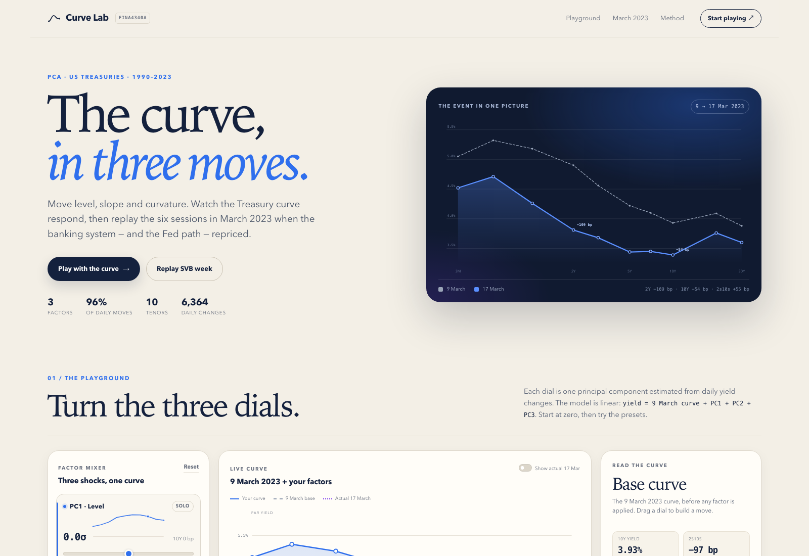

# Curve Lab — the Treasury curve in three moves

A small, static three-factor PCA toy for the US Treasury yield curve, built around the 9–17 March 2023 bank-stress episode.

## What is inside

| File | What it is |
| --- | --- |
| `index.html` | The toy |
| `style.css` | The styling |
| `app.js` | Sliders, charts, presets, replay |
| `data.js` | PCA loadings, curves and event data |
| `Yield_Curve_PCA_Report.docx` | The full Word report |
| `preview.png` | The screenshot used above |
| `.nojekyll` | Keeps GitHub Pages from running Jekyll |

## Publish on GitHub Pages

1. Create a repository.
2. Upload **all files in this folder** to the repository root.
3. Go to **Settings → Pages**.
4. Under **Build and deployment**, choose **Deploy from a branch**.
5. Pick branch **main** and folder **/(root)**, then save.
6. Open `https://<your-username>.github.io/<repo>/`.

No build step, no server, no dependencies. The site also works if you open `index.html` directly.

## What the toy does

- **PC1, PC2, PC3 sliders.** Move level, slope and curvature. The curve, the change bars and the readout update live.
- **Solo.** Isolate one factor to see its shape.
- **SVB week.** Set the sliders to the actual factor scores for 9 → 17 March 2023 and overlay the actual 17 March curve.
- **Replay.** Move through the seven closes of the week and see the curve and the 2Y/10Y/2s10s readout.
- **Presets.** Bull steepener, bear flattener, belly twist.

## The result in one paragraph

The first three principal components explain 96.0% of daily yield-curve variance (PC1 level 67.9%, PC2 slope 23.4%, PC3 curvature 4.7%). From 9 to 17 March 2023 the 2Y fell 109 bp, the 10Y 54 bp and the 30Y 28 bp, so 2s10s steepened 55 bp. The factor scores were PC1 −208 bp (−14.0 daily σ), PC2 +66.5 bp (+7.6σ) and PC3 +39.4 bp (+10.0σ). PC1 did most of the level work; PC2 and PC3 made the move a steepener. The 3-factor fit leaves a 9.5 bp residual at the 2Y, so it is a good summary, not a perfect fit.

## Data and disclaimer

US Treasury daily par yield curve rates, CBOE VIX and S&P 500. PCA is estimated on daily changes through 8 March 2023. The PPN in the report is an indicative pricing exercise, not an offer. This is a student project for FINA4340A; not investment advice.
